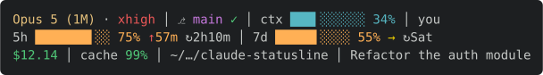

# claude-statusline

A three-row [Claude Code](https://code.claude.com) status line: context and rate-limit gauges with **pace projection**, and your month-to-date extra-usage spend read straight from Anthropic's own meter.



```
Opus 5 (1M) · xhigh │ ⎇ main ~1 ?12 │ ctx ▉░░░░░░░░░ 9% │ you
5h ███████▌░░ 75% ↑57m ↻2h10m │ 7d █████▌░░░░ 55% → ↻Sat │ Fable █████▎░░░░ 52% ↑Sun 4PM ↻Mon
$12.14 │ cache 99% │ 6:24PM │ ~/…/myproject │ Refactor the auth module
```

POSIX shell, no dependencies beyond `jq` and the usual coreutils (`curl` if you want the model-scoped gauge). ~19 subprocesses and ~160 ms per render.

## What you're looking at

**Row 1 — identity and workspace.** Model (amber Opus, blue Sonnet, cyan Haiku, crimson Fable) · reasoning effort (dim → cyan → orange → red) │ git branch with `✓` clean or `+N` staged / `~N` modified / `?N` untracked, plus `⇡N` / `⇣N` divergence │ context-window gauge │ the [logged-in account](#the-account-label), as the part of its email before the `@`.

**Row 2 — rate limits.** The 5-hour and 7-day windows, each as `gauge · percent · pace verdict · reset` — plus a gauge per [model-scoped weekly limit](#the-model-scoped-weekly-gauge) when your plan has one, labeled with the model's name in its color.

**Row 3 — session vitals.** Session cost │ cache hit rate │ last interaction │ working directory │ session name.

Gauges use eighth-block sub-cell fills, so 10 columns give 80 steps of resolution — a 1% change is visible. Threshold colors: green under 50%, orange 50–79%, red 80%+.

## The pace verdict

The gauge tells you how much you've used. The arrow tells you whether that's a problem.

| | Meaning |
|---|---|
| `↓` green | Under pace — you'll finish the window with headroom. No time shown; there's nothing to predict. |
| `→` yellow | On pace to land near 100% at reset. |
| `↑` red | Overspending, **plus the moment you'd hit the cap**. |

So `5h ███████▌░░ 75% ↑57m ↻2h10m` reads: three-quarters spent, and at this rate you're capped in 57 minutes — but the window doesn't reset for 2h10m, leaving you locked out for over an hour.

Two independent colors: the **arrow** is the pace verdict, the **time** is urgency (how early exhaustion lands relative to the window remaining). A yellow `→` with a green time is very different from a red `↑` with a red one.

### The two windows are modelled differently — deliberately

The 5-hour window uses **linear projection**: `used% × window ÷ elapsed`. At session scale that's fair, because a 5-hour block is roughly one work session and burn is continuous while you're in it.

Applying the same math to 7 days is wrong. Wall-clock elapsed over a week includes nights and weekends, when burn is zero. If the window opened Wednesday and it's Friday evening, elapsed reads 31% while you've done essentially all the week's work — the projection screams even though the weekend will flatten it.

So the 7-day window compares **daily rates** instead:

```
actual/day    = used ÷ days_elapsed
allowance/day = (100 − used) ÷ days_left
```

Both sides are averages, so burstiness cancels. Units differ to match: the 5h window reports durations (`↑57m`, `↻2h10m`) because you think in minutes at that scale; the 7d window reports weekdays (`↑Thu 5PM`, `↻Sat`) because at week scale a duration forces the reverse conversion — "72h… so Saturday?"

### When the arrow goes quiet

- **At the cap** — 🤑 replaces the arrow. Projecting exhaustion when you're already exhausted is noise.
- **In the first 2% of a window** — no arrow at all. Early projections divide by a tiny elapsed time and produce nonsense.
- **When exhaustion would land past the reset** — arrow shows, timestamp doesn't. You can be over allowance and still never run out, because the window refills first.

## The extra-usage spend figure

If your plan bills extra usage once subscription caps are hit, row 3's second figure is your month-to-date spend on it.

```
$12.14 ·$480.80 🤑
└ green   └ red
```

The green figure is `cost.total_cost_usd` — **this session**, every token, subscription-covered or not. The red figure is **Anthropic's own extra-usage meter**: `spend.used` from the OAuth usage response, the same number the [usage page](https://claude.ai/settings/usage) shows. It appears once it's non-zero and hides when the cache is stale, unreachable, or the account has no extra usage.

It costs no extra network traffic — the [model-scoped gauge](#the-model-scoped-weekly-gauge) already refreshes that cache every five minutes, and this reads one more field out of it. `spend.used` is minor units plus an exponent (`48080` at exponent `2` is `$480.80`), so no float parsing is involved; the older `extra_usage.used_credits` / `decimal_places` pair carries the same number and is kept as a fallback.

There's nothing to reconcile, which is the point — it *is* the invoice figure. Set an optional denominator with `statusline-command.sh budget 200` to render it as `$480.80/200`.

### Why this replaced a local ledger

Earlier versions accumulated `cost.total_cost_usd` deltas into per-session files under `~/.claude/usage/YYYY-MM/`, gated on cap exhaustion. On the account this was developed against it read **$1266.13 against an actual $480.80** — 2.6× high, for two independent reasons.

**The quantity was wrong.** `total_cost_usd` prices every token at list API rates, and the gate is all-or-nothing: once `five_hour ≥ 100 || seven_day ≥ 100`, *all* of a session's cost delta was booked as overflow. That is not the same thing as credits consumed, and no amount of care in the accumulator would have made it so. Four sessions in that month had an accrued total equal to their entire session cost, to the cent.

**And the arithmetic was wrong too**, for about $240 of it. `total_cost_usd` is not monotonic — a resumed session re-reports from a lower baseline. The accumulator floored negative deltas at zero, which is right, but then kept the accrued total *and* rewrote `last_cost` downward, so the whole climb back was counted a second time. The tell is visible in the old state files: one session's `accum` was $1145.11 against its own `last_cost` of $904.63, and a sum of non-negative deltas cannot exceed the counter's final value. Reconstructing that session independently from its transcript's per-request `usage` (plus 72 subagent transcripts) put it at ~$788 at list rates, confirming `last_cost` as the sound side.

Both failure modes are structurally impossible now: the figure is a field read from a response, not a running total. `statusline-preview.sh spend` asserts that — including that the figure stays pinned across six renders with a rising cost and a dip to zero.

Old `~/.claude/usage/YYYY-MM/` directories are inert; delete them at your leisure.

## The model-scoped weekly gauge

Some plans carry a weekly limit for one specific model on top of the all-models window — the extra row on claude.ai's usage page. Claude Code doesn't pass it to the status line: the payload's `rate_limits` has exactly `five_hour` and `seven_day`, in every version to date. The only place the number exists is the OAuth usage endpoint claude.ai itself reads (`api.anthropic.com/api/oauth/usage`), so this script reads it too — with the constraint that a status line redraws every few seconds and that endpoint 429s eagerly even at modest polling rates.

The design keeps the network off the render path entirely:

- A render that finds the refresh stamp older than **5 minutes** advances the stamp and hands the fetch to a **detached background job**; the gauge always draws from the cache file the last successful fetch left behind (`~/.claude/usage/.oauth_usage.json`).
- The stamp advances even when the fetch fails, so a dead endpoint or a denied keychain costs one attempt per interval, not one per redraw.
- An error body never overwrites the cache — a 429 or an expired token can't blank a gauge that had good data. The raw response always lands next to the cache (`.oauth_usage.json.raw`) for debugging.
- Data older than an hour hides the gauge rather than rendering it. A gauge is a claim about *now*; an hour-old figure with a pace arrow on it is a lie.

Model-scoped windows arrive in the response's `limits[]` array (`kind: "weekly_scoped"`, model name under `.scope`); the older top-level `seven_day_<model>` keys — null fossils on current accounts — are kept as a fallback. Each window renders after the 7d gauge with the same weekly pace model and reset marker, and a scoped window at 100% raises the 🤑 glyph **only when it caps the model you're actually running** — Opus capped doesn't flag a Sonnet session.

🤑 means *a cap is exhausted right now*, and nothing more. It's read off the payload's rate-limit percentages, which is a fact you can know locally; it deliberately no longer attributes any dollar amount, since that was the inference that made the old ledger wrong.

The OAuth token is found by trying, in order: `~/.claude/.credentials.json` (Linux, and silent), the macOS keychain item keyed by your login name, then any `Claude Code-credentials` item. Every candidate passes an expiry pre-check before it's spent on a request — the endpoint's rate limiting is too aggressive to burn a call on a token a local timestamp already condemns. macOS may show one keychain consent dialog on first fetch; "Always Allow" ends them. The token never touches disk and never leaves the machine except to Anthropic's own endpoint.

Set `CLAUDE_SL_NO_OAUTH=1` to turn the whole thing off — no fetch, no gauge, and no spend figure (it reads the same cache). Rows 1 and 2's other segments are untouched.

Worth being honest about: the endpoint is unofficial and undocumented, so its shape can change without notice. When it does, the gauge disappears (the parser finds nothing) rather than rendering garbage — and the rest of the status line doesn't care.

## The account label

If you switch between Claude Code accounts, row 1 ends with a dim label confirming which one is active: `you@example.com` shows as `you`. Names longer than 20 characters are cut to 19 plus `…`.

The payload doesn't say who is logged in, but Claude Code's own config does: `oauthAccount.emailAddress` in `~/.claude.json`, or in `$CLAUDE_CONFIG_DIR/.claude.json` when that's set — so each config dir shows its own account. API-key, Bedrock and Vertex logins have no `oauthAccount`, and the label stays hidden.

That file runs to a few hundred KB and Claude Code rewrites it often, so the label is cached in the usage dir (`.account`) and re-read only when the config file is newer than the cache. Most renders cost no extra process. The cache records which config file it came from, so a usage dir shared across config dirs can't show one account's name in another's session.

The label appears in every screenshot, recording and screen share of your terminal. Set `CLAUDE_SL_NO_ACCOUNT=1` to hide it.

## Install

Requires Claude Code and `jq`.

```sh
git clone https://github.com/emcodeio/claude-statusline.git
cd claude-statusline
ln -s "$PWD/statusline-command.sh" ~/.claude/statusline-command.sh
ln -s "$PWD/statusline-preview.sh" ~/.claude/statusline-preview.sh
```

Then in `~/.claude/settings.json`:

```json
{
  "statusLine": {
    "type": "command",
    "command": "sh \"$HOME/.claude/statusline-command.sh\""
  }
}
```

Symlinking (rather than copying) means every edit you make is already in the working tree — the repo and the live script can't drift apart.

**Optionally** add `"refreshInterval": 3` alongside `"command"`. Status lines are event-driven — they re-run on a new assistant message, `/compact`, permission-mode and vim-mode changes, but **not** on terminal resize and not while idle. Without an interval, the countdowns stop being true the moment rendering stops.

### Preview every state without waiting for it

```sh
bash statusline-preview.sh            # 14 render states + all assertions
bash statusline-preview.sh spend      # spend-figure + regression assertions
bash statusline-preview.sh account    # account-label assertions
```

The harness is hermetic: it builds its own clean and dirty git repos, redirects the usage dir and the config dir to a scratch dir, and pins the clock so pace projections are deterministic. It never touches `~/.claude/usage` or reads your `.claude.json` — every state shows a placeholder account, `you`. Any failed assertion exits non-zero, so it works as a pre-commit check.

### Regenerating the screenshot

`screenshot.svg` is rendered from real ANSI output rather than captured, so it stays crisp and diffs as text. The committed demo payload carries a placeholder path; substitute a real repo at render time so the git segment appears. The account label comes from a throwaway config dir holding a placeholder account:

```sh
fake=$(mktemp -d)
printf '{"oauthAccount":{"emailAddress":"you@example.com"}}' > "$fake/.claude.json"
jq --arg cwd "$PWD" '.workspace.current_dir = $cwd' tools/demo-payload.json \
  | CLAUDE_CONFIG_DIR="$fake" CLAUDE_SL_NOW=1785355000 CLAUDE_USAGE_DIR=$(mktemp -d) \
    sh statusline-command.sh \
  | python3 tools/ansi-to-svg.py > screenshot.svg
```

The pinned `CLAUDE_SL_NOW` keeps the rendered durations stable across regenerations. It also keeps your name out of the image: with `CLAUDE_SL_NOW` set and no `CLAUDE_CONFIG_DIR`, the script never reads `~/.claude.json`, so leaving out the fake config dir drops the label rather than publishing the account of whoever ran the command.

## Gotchas worth knowing

Each of these cost real debugging time.

**Display width is not `${#var}`, and it is not `awk`'s `length()`.** The block glyphs are 3 bytes and 1 column each. Byte counts overstate a gauge row by ~50, and `${#var}` counts characters, which still misses the double-width emoji. The reliable route: strip ANSI, map wide glyphs to two cells, map every remaining character to one byte, then count bytes.

**Terminal width comes from `$COLUMNS`, never `tput cols`.** Claude Code captures the script's stdout rather than attaching it to the terminal, so `tput` has no tty to query and silently returns 80. Claude Code exports `COLUMNS` and `LINES` before running the script (v2.1.153+).

**`stat -f` half-succeeds on GNU.** `stat -f %m file` is BSD's mtime query; on GNU coreutils `-f` means `--file-system`, so a BSD-first `||` fallback chain never fires and you get garbage instead of a timestamp. Validate that the result is a bare integer rather than trusting the exit code. The same BSD-first pattern *is* correct for `date` (`-r` vs `-d @`), which fails cleanly.

**Don't assume one toolchain.** A machine can pair BSD `sed` with GNU `date`/`stat` (Nix on macOS does). `sed -i` is the classic casualty — its syntax differs. Rewriting via temp file plus `mv` works under either.

**Tab is IFS whitespace.** Splitting `@tsv` output with `IFS=$'\t'` collapses consecutive tabs into one delimiter, so a single empty field silently shifts every field after it. Read newline-delimited instead.

**`## No commits yet on <branch>`.** Git's porcelain branch header on an unborn HEAD isn't a branch name. Strip the prefix or the status line reports the whole sentence as your branch.

**`security find-generic-password` returns *a* match, not *the* match.** Old Claude Code versions leave a fossil item on the same `Claude Code-credentials` service (account `"Claude Code"`), and the bare `-s` lookup happily returns its long-expired token while the live one — keyed by your login name — sits right next to it. Query with `-a "$USER"` first, and pre-check `expiresAt` before trusting anything either lookup returns.

**Subprocess count is the performance budget.** This redraws constantly, so each helper collapses its work into a single `awk`, git state comes from one combined `status --porcelain --branch` (28 ms versus 79 ms for three separate calls), and the `date` flavour is probed once rather than per call.

## Credit

The pace-arrow idea — projecting end-of-window usage and surfacing it as a single glyph — comes from [vfmatzkin/claude-statusline](https://github.com/vfmatzkin/claude-statusline). The gauges, the daily-allowance model for the weekly window, and the extra-usage spend readout are this implementation's own.

## License

MIT — see [LICENSE](LICENSE).
